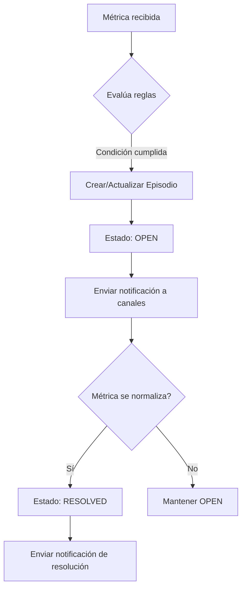

# Alertas - Visión General

SPSAAS implementa un sistema de alertas basado en **reglas de evaluación continua** sobre métricas recolectadas por los agentes. El diseño prioriza **evitar ruido** (alert fatigue) mediante episodios, silenciamiento y configuración flexible de canales.

## Conceptos clave

| Concepto | Descripción |
|----------|-------------|
| **Regla de Alerta (AlertRule)** | Define qué métrica vigilar, umbral, duración, severidad y canales de notificación |
| **Episodio (Alert)** | Una alerta activa que persiste mientras se cumple la condición; evita alertas duplicadas |
| **Silenciamiento** | Suprimir notificaciones temporalmente sin desactivar la regla |
| **Canal (Channel)** | Medio de entrega: email, webhook, Telegram, etc. |

## Flujo de vida de una alerta



## Crear una regla de alerta

### Desde la Web UI

1. Ve a **Alertas → Reglas → Nueva**
2. Completa el formulario:

| Campo | Descripción |
|-------|-------------|
| **Nombre** | Identificador único (ej: `CPU alta en web-servers`) |
| **Tipo de entidad** | `Server`, `Service`, `Process`, `Job` |
| **Entidad** | Específica (dejar vacío = todas las de ese tipo en el tenant) |
| **Métrica** | `cpu_usage`, `memory_usage`, `disk_usage`, `process_count`, etc. |
| **Operador** | `>`, `<`, `>=`, `<=`, `==`, `!=` |
| **Umbral** | Valor numérico (ej: `80` para 80%) |
| **Duración (s)** | Segundos que debe mantenerse la condición (ej: `60`) |
| **Severidad** | `info`, `warning`, `critical` |
| **Canales** | Email, Webhook, Telegram (según tu plan) |
| **Activa** | Sí/No |

### Via API

```bash
curl -X POST https://tu-instancia.spsaas.com/api/v1/alerts/rules \
  -H "Authorization: Bearer $TOKEN" \
  -H "Content-Type: application/json" \
  -d '{
    "entity_type": "server",
    "entity_id": null,
    "metric": "cpu_usage",
    "operator": "gt",
    "threshold": 80,
    "duration_s": 60,
    "severity": "warning",
    "channels": {
      "email": { "to": ["ops@empresa.com"] },
      "telegram": { "chat_id": "-1001234567890" }
    },
    "is_active": true
  }'
```

## Tipos de entidad y métricas disponibles

| Entity Type | Métricas comunes |
|-------------|------------------|
| **Server** | `cpu_usage`, `memory_usage`, `disk_usage`, `network_rx_bytes`, `network_tx_bytes`, `load_1m`, `load_5m`, `load_15m` |
| **Service** | `service_status` (1=running, 0=stopped), `process_count`, `cpu_usage`, `memory_usage` |
| **Process** | `process_count`, `cpu_usage`, `memory_usage`, `open_fds`, `threads` |
| **Job** | `job_status` (success/failed/timeout), `duration_seconds`, `exit_code` |

## Silenciamiento y Deduplicación

### Silenciamiento manual
- Desde la lista de alertas: clic en **Silenciar** → elige duración (1h, 4h, 24h, personalizado)
- La alerta sigue evaluándose pero **no envía notificaciones**
- Auto-expira al cumplirse el tiempo o al resolver

### Silenciamiento automático (ack)
- Al hacer **Acknowledge** (reconocer) una alerta, se silencia por 1 hora por defecto
- Configurable por regla: `silence_after_ack_seconds`

### Anti-flapping (anti-rebote)
- Un episodio **no se resuelve** hasta que la condición deja de cumplirse por completo
- Si la métrica oscila alrededor del umbral, el episodio se mantiene **OPEN**
- Nueva violación tras resolución → **nuevo episodio** (no re-abre el anterior)

## Canales de notificación

| Canal | Plan mínimo | Configuración |
|-------|-------------|---------------|
| **Email** | Free | `to` (array de emails), opcional `subject_template` |
| **Telegram** | Starter | `chat_id` (ej: `-1001234567890`), `thread_id` opcional, `silent` boolean |
| **Webhook** | Growth | `url`, `headers` (opcional), `secret` para firma HMAC |
| **WhatsApp** | Growth | Via proveedor externo (Twilio, etc.) |
| **Slack/PagerDuty** | Enterprise | Integración nativa |

### Formato de payload Webhook

```json
{
  "alert": {
    "id": "uuid",
    "rule_id": "uuid",
    "rule_name": "CPU alta en web-servers",
    "severity": "warning",
    "status": "open",
    "entity_type": "server",
    "entity_id": "uuid",
    "entity_name": "web-01",
    "metric": "cpu_usage",
    "operator": "gt",
    "threshold": 80,
    "current_value": 87.3,
    "started_at": "2026-10-08T14:30:00Z",
    "tenant_id": "uuid"
  },
  "event": "alert_created"  // o "alert_resolved", "alert_acknowledged"
}
```

## Buenas prácticas

1. **Empieza conservador**: Umbrales altos, duración > 60s
2. **Agrupa por severidad**: Canales `critical` → PagerDuty/Telegram urgente; `warning` → Email
3. **Evita reglas sobre `all entities`** salvo para métricas globales (ej: `disk_usage > 90%`)
4. **Documenta cada regla**: Usa el campo descripción para runbooks
4. **Revisa mensualmente**: Ajusta umbrales según estacionalidad

## Referencia API

| Endpoint | Descripción |
|----------|-------------|
| `POST /api/v1/alerts/rules` | Crear regla |
| `GET /api/v1/alerts/rules` | Listar reglas |
| `GET /api/v1/alerts/rules/{id}` | Obtener regla |
| `PATCH /api/v1/alerts/rules/{id}` | Actualizar regla |
| `DELETE /api/v1/alerts/rules/{id}` | Eliminar regla |
| `POST /api/v1/alerts/{id}/ack` | Reconocer alerta |
| `POST /api/v1/alerts/{id}/resolve` | Resolver alerta manualmente |
| `GET /api/v1/alerts` | Listar alertas (con filtros) |